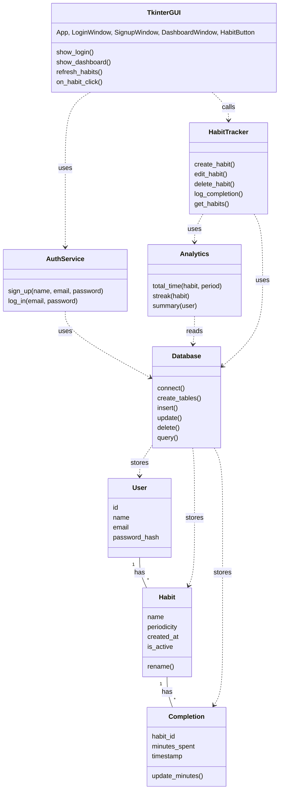
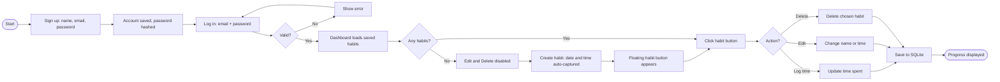

# Habit Tracker: Text Versions of the Diagrams

This file describes two diagrams in plain text so they can be read without the images:

1. The UML class diagram (`uml_class_diagram.png`)
2. The user flow diagram (`user_flow_diagram.png`)

---

## 1. UML Class Diagram

The classes are arranged in four layers: GUI, logic, database, and data classes.

### Layer 1: GUI (Tkinter)

**Tkinter GUI** groups five classes: `App`, `LoginWindow`, `SignupWindow`, `DashboardWindow`, `HabitButton`.
- Methods: `show_login()`, `show_dashboard()`, `refresh_habits()`, `on_habit_click()`

### Layer 2: Logic

**AuthService**
- Methods: `sign_up(name, email, password)`, `log_in(email, password)`

**HabitTracker**
- Methods: `create_habit()`, `edit_habit()`, `delete_habit()`, `log_completion()`, `get_habits()`

**Analytics**
- Methods: `total_time(habit, period)`, `streak(habit)`, `summary(user)`

### Layer 3: Database

**Database**
- Methods: `connect()`, `create_tables()`, `insert()`, `update()`, `delete()`, `query()`

### Layer 4: Data classes

**User**
- Attributes: `id`, `name`, `email`, `password_hash`

**Habit**
- Attributes: `name`, `periodicity` (daily or weekly), `created_at`, `is_active`
- Methods: `rename()`

**Completion**
- Attributes: `habit_id`, `minutes_spent`, `timestamp`
- Methods: `update_minutes()`

### Relationships

Dependencies (dashed arrows in the diagram, "A -> B" means A depends on B):

| From | To | Label |
| --- | --- | --- |
| Tkinter GUI | AuthService | uses |
| Tkinter GUI | HabitTracker | calls |
| HabitTracker | Analytics | uses |
| HabitTracker | Database | uses |
| AuthService | Database | uses |
| Analytics | Database | reads |
| Database | User | stores |
| Database | Habit | stores |
| Database | Completion | stores |

Associations (solid lines, with multiplicity):

| From | To | Label | Multiplicity |
| --- | --- | --- | --- |
| User | Habit | has | one User has many Habits (1 to *) |
| Habit | Completion | has | one Habit has many Completions (1 to *) |

Key design rule: the GUI never talks to the Database directly. It goes through AuthService or HabitTracker.

### Mermaid version

---

## 2. User Flow Diagram

The diagram shows what happens from first sign up to viewing progress. Shapes in the image: rounded ends are start and end, rectangles are steps, diamonds are decisions.

### Steps in order

1. **Start**
2. **Sign up:** name, email, password
3. **Account saved,** password hashed
4. **Log in:** email + password
5. **Valid?** (decision)
   - No: **Show error**, then go back to step 4 (Log in)
   - Yes: continue to step 6
6. **Dashboard loads** saved habits
7. **Any habits?** (decision)
   - No: **Edit and Delete disabled**, then **Create habit** (date and time auto-captured), then **Floating habit button appears**, then step 8
   - Yes: go straight to step 8
8. **Click habit button**
9. **Action?** (decision with three branches)
   - Log time: **Update time spent**
   - Edit: **Change name or time**
   - Delete: **Delete chosen habit**
10. All three branches lead to **Save to SQLite**
11. **Progress displayed** (end)

### Connections as a list

- Start -> Sign up
- Sign up -> Account saved
- Account saved -> Log in
- Log in -> Valid?
- Valid? -> (No) Show error
- Show error -> Log in
- Valid? -> (Yes) Dashboard loads saved habits
- Dashboard loads saved habits -> Any habits?
- Any habits? -> (No) Edit and Delete disabled
- Edit and Delete disabled -> Create habit
- Create habit -> Floating habit button appears
- Floating habit button appears -> Click habit button
- Any habits? -> (Yes) Click habit button
- Click habit button -> Action?
- Action? -> (Log time) Update time spent
- Action? -> (Edit) Change name or time
- Action? -> (Delete) Delete chosen habit
- Update time spent -> Save to SQLite
- Change name or time -> Save to SQLite
- Delete chosen habit -> Save to SQLite
- Save to SQLite -> Progress displayed

### Mermaid version

